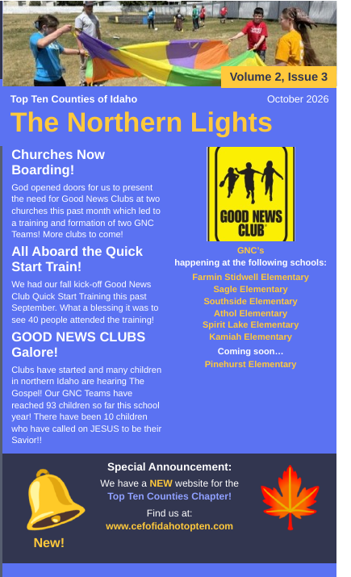
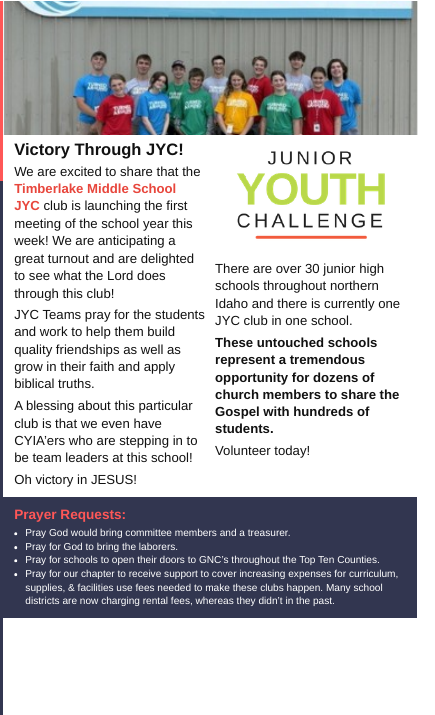
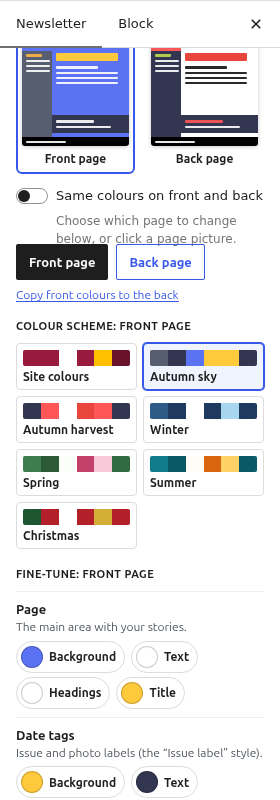
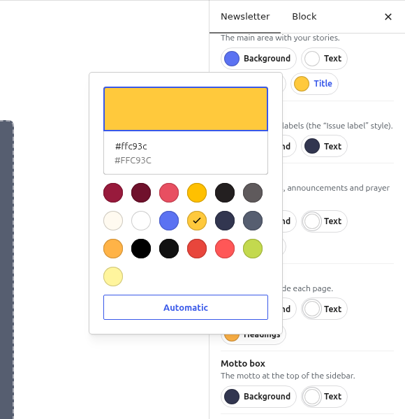
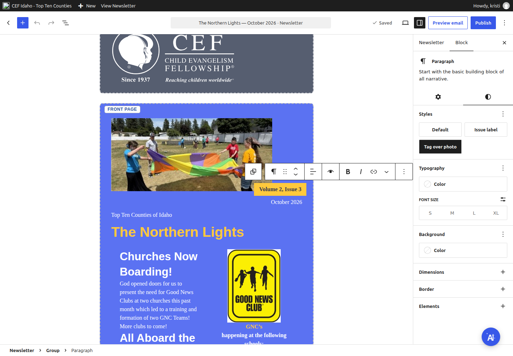

# Newsletter colours: a step-by-step tutorial

Each newsletter can have its own colour scheme, and the front and back pages can use
different colours, for example a blue autumn front page and a white and coral back page.
Changes show in the editor straight away. The website, the printed letter and the email
all use the same colours.

| Front page ("Autumn sky") | Back page ("Autumn harvest") |
|---|---|
|  |  |

## 1. Start the issue

1. Go to **Newsletters → All newsletters**.
2. Next to last month's issue, click **Copy to start a new issue**. The copy keeps your
   sidebar, footer and colours. Only the front and back pages need new content.
3. Click the title and type the new issue name.

## 2. Choose the colours

In the editor's right-hand sidebar, open the **Newsletter** tab, then the **Colours** panel.

- The two small pictures at the top show the **front page** and the **back page** in their
  current colours.
- **Same colours on front and back** is on by default. Turn it off to give each page its
  own colours. Then pick the page to change with the **Front page** and **Back page**
  buttons, or click one of the small pictures.
- **Colour scheme**: click a ready-made scheme. It applies to the selected page, or to both
  pages when they share colours. **Site colours** returns to your website's own colours.
- **Copy front colours to the back** starts the back page from the front page's colours.

### Fine-tune any part

Under **Fine-tune**, each part of the page has its own colour buttons:

| Part | What it colours |
|---|---|
| **Page** | The main area. *Background*, *Text*, *Headings* and *Title* (the newsletter name). |
| **Date tags** | Issue labels and photo labels (paragraphs with the **Issue label** or **Tag over photo** style). |
| **Highlight box** | Boxes for events, announcements and prayer requests. |
| **Sidebar** | The column beside each page. |
| **Motto box** | The motto at the top of the sidebar. |
| **Contact box** | The address box in the sidebar. |
| **Footer strip** | The strip along the bottom of each page. |

Click a colour button and choose a colour. The list shows your website's colours and the
colours already used in this issue. To use another colour, click the large colour bar at the
top and type a hex code, such as `#ffc93c`.

- Text left on **Automatic** switches between dark and light so it stays readable on its
  background.
- **Use the site colour** undoes a background change.
- **Reset all colours to the site colours** at the bottom of the panel undoes every change.
- Colour changes can be undone like any other edit (**Undo** or Ctrl+Z).

## 3. Colour single words and paragraphs

- **Single words** (for example, a school name in red): select the words, click the **⌄**
  (More) button in the block toolbar, then **Highlight**. Choose the **Text** tab and a colour.
- **A whole paragraph or heading**: select the block, open **Block → Styles** (the
  half-circle icon), then under **Typography** choose **Color**.
- **Bold**: select the words and press Ctrl+B (⌘B on a Mac). In a paragraph with line
  breaks, press Ctrl+A to select all of its text, then Ctrl+B.
- **Larger text**: in **Block → Styles → Typography**, choose S, M, L or XL. Print scales
  these sizes so the letter still fits on two pages.
- **Centre text**: use **Align text** in the block toolbar.

## 4. Issue labels and tags

Select a paragraph, then in **Block → Styles** choose a style:

- **Issue label**: a full-width coloured bar.
- **Tag over photo**: a coloured tag on the bottom-right corner of the photo above it, as on
  the front page of the example.

**Tip:** a right-aligned paragraph (such as the issue date) placed directly above the
kicker ("Top Ten Counties of Idaho") is printed on the same line, at the right.

## 5. Columns, pictures and boxes

- **Two columns**: in an empty box, click **+**, search for **Columns** and choose
  **50 / 50**. For a picture, text and another picture side by side, choose **25 / 50 / 25**.
  Printing keeps the column widths you choose.
- **Pictures**: add an **Image** block. Use **Upload** for a new file or **Media Library**
  for a picture you already have. To change a picture, select it and click **Replace**.
  Always fill in **Alternative text**.
- **Remove old content**: click the first block, Shift+click the last block and press Delete.
  To remove a whole set of columns, click inside it, click **Select parent block** in the
  toolbar until **Columns** is selected, then choose **⋮ → Delete**.

## 6. Check, print and send

1. Click **Save draft**.
2. In **Publish, print & email**, click **Print / Save as PDF**. The preview says
   **Fits on two pages. Ready to print.** If a page is too long, shorten the text, use a
   smaller size or remove a picture.
3. Click **Send me a test email** and check the email before using **Send to subscribers…**.

## Video

A captioned screen recording of the whole example (about 6 minutes) shows every step above.
It was recorded with an automated browser on a local test site.
