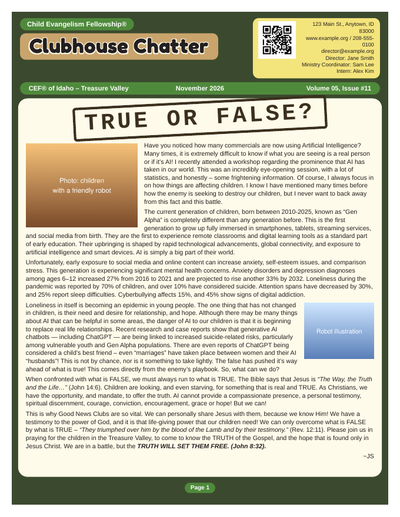
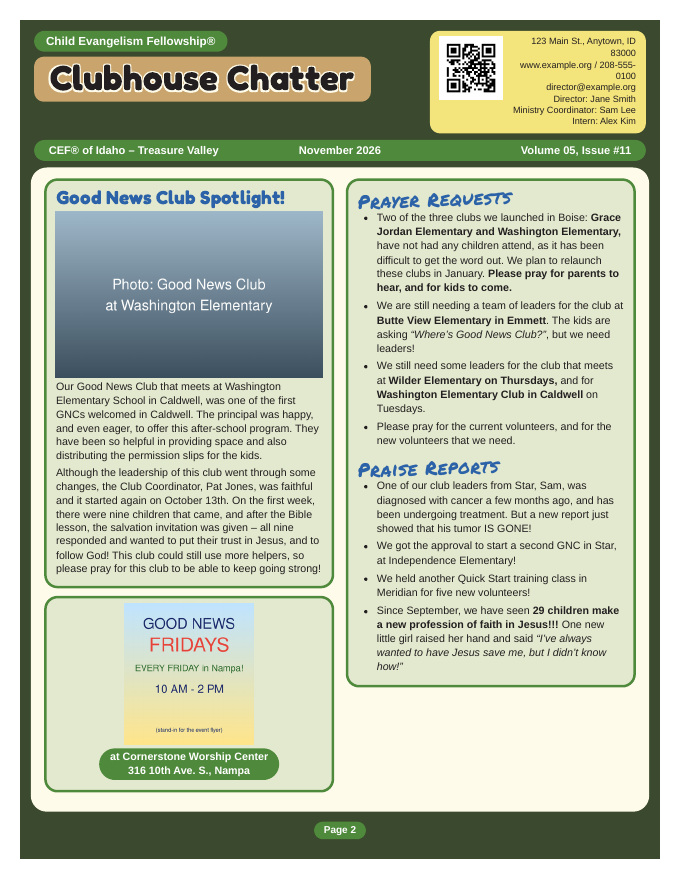
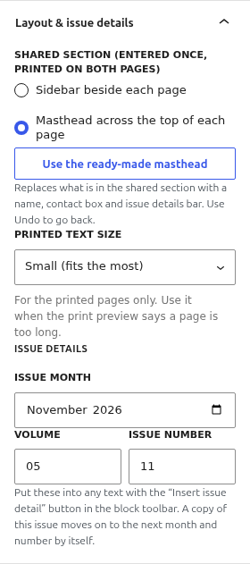
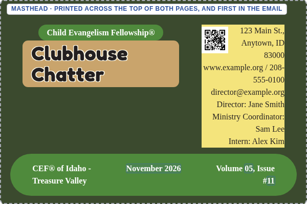
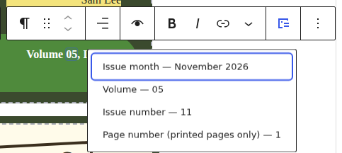
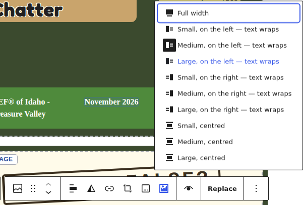

# Recreating a printed newsletter

This guide rebuilds a typical two-page ministry newsletter in the editor: a
masthead across the top of both pages, a long front-page letter with wrapped
photos, and a back page with boxes for a club spotlight, an event flyer, and
prayer and praise lists. Everything is done with the editor's buttons; nothing
needs code.

The result, printed:

| Front | Back |
|---|---|
|  |  |

(The photos are stand-ins.)

## 1. Choose the layout and issue details

Start a newsletter (Newsletters → Write a newsletter, or **Copy to start a new
issue** on last month's). In the sidebar, open **Layout & issue details**:

1. Choose **Masthead across the top of each page**.
2. Click **Use the ready-made masthead**. It adds your organization's name, a
   newsletter name plaque, a contact box and a bar with the month, volume and
   issue number. Undo takes it back.
3. Set the **Issue month**, **Volume** and **Issue number**.

When you copy this issue next month, the copy moves on to the next month and
issue number by itself, so the masthead never shows last month's date.

## 2. Fill in the masthead

Click into the masthead and type over the sample text: the organization name
(a **Pill**), the newsletter name (a **Nameplate** heading), and the contact
box. Press Shift+Enter for a new line inside the contact box.

To add a QR code, put the cursor in the contact box, press **+** (or type
`/qr`) and choose **QR code**. Type the web address and click **Create QR
code**. It becomes an image: use **Photo size and text wrap → Medium, on the
left** so the address sits beside it. About an inch across scans reliably.

## 3. Issue details in any text

The month, volume, issue number and page number are **issue details**. Click
where one should go and use the **Insert issue detail** button in the block
toolbar:

They are filled in on the website, on paper and in the email. The page number
prints 1 or 2 and is left out of the website and email. The footer of this
example is just "Page " followed by the page number, styled as a **Pill**.

## 4. Front page: a letter with wrapped photos

- Headline: a heading with the **Stamp** style (Block → Styles), centred.
- Type or paste the letter. Bold and italics work as usual (Ctrl+B, Ctrl+I).
- To add a photo beside the text, click the paragraph it belongs to, press
  **+**, choose **Image** and upload. Then use the **Photo size and text wrap**
  menu on the image toolbar: small, medium or large, on the left or the right.
  The text wraps around it on the website and in print.

- A signature such as "~AJ": a paragraph aligned right.

## 5. Back page: boxes in two columns

1. Type `/columns` and choose **50 / 50**.
2. In the left column, add a heading (style **Playful**), a photo and the
   story. Select them all (click the first, Shift+click the last), choose
   **Options (⋮) → Group**, then the **Rounded box** style.
3. Below it, add the event flyer and a **Pill** paragraph with the address,
   and group them into another **Rounded box**. Pictures in boxes are never
   cropped, so flyers stay readable.
4. In the right column, add **Handwritten** headings for "Prayer Requests" and
   "Praise Reports" with a bulleted list under each (type `- ` to start a
   list), and group them into a **Rounded box**.

Boxes use the colour of the issue's tags; pick another background or border on
the box itself if you like.

## 6. Colours

In **Colours**, the **Campfire** scheme gives a dark green page border, a wood
nameplate and a yellow contact box. **Page border** adds a coloured edge with
rounded paper inside; leave it "Same as the page" for none.

## 7. Check the print preview

Click **Print / Save as PDF**. The preview says whether each page fits. If a
page is too long, shorten the text, make a photo smaller, or choose a smaller
**Printed text size** (Compact or Small) in **Layout & issue details**. Nothing
is shrunk or hidden for you.

The website shows the masthead once, then both pages. The email starts with
the masthead, then the stories in order; photos keep their size but cannot
wrap, and the page number is left out.
